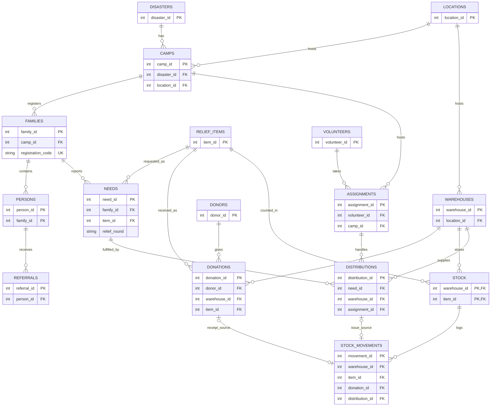

# Final ER Diagram

This diagram matches the implemented MySQL tables in [`database/schema.sql`](../../database/schema.sql). PK means primary key, FK means foreign key, and UK means unique key. Each `STOCK` row is identified by its warehouse and item together.

The distribution's item comes from its linked `NEEDS` row. The Python transaction checks that the chosen warehouse has stock for that same item. One donation or distribution has one matching stock movement; `STOCK_MOVEMENTS` keeps both source IDs optional because a movement is either a receipt or an issue.

